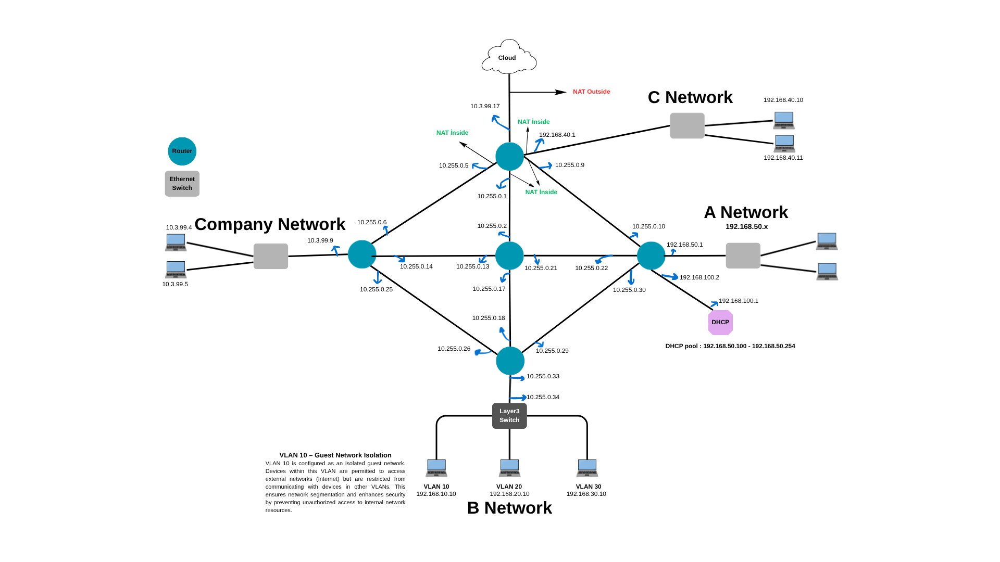

# STAR-TOP | Enterprise Network Infrastructure

**A Comprehensive Enterprise Network Simulation Project Developed with GNS3**


---

## 1. Project Overview

**STAR-TOP** is an enterprise network infrastructure simulation project designed and implemented using **GNS3** and Cisco network devices.

The project focuses on designing, configuring, and testing a scalable enterprise network architecture that integrates multiple routing domains, Layer 3 switching, network segmentation, dynamic routing, address assignment, network address translation, and access control.

The infrastructure consists of interconnected Cisco routers, a Layer 3 switch, DHCP services, virtual PCs, and external network connections.

The primary objective is to simulate a realistic enterprise network environment while implementing essential networking technologies and validating end-to-end connectivity between different network segments.

## 2. Project Objectives

The main objectives of STAR-TOP are:

- Design a multi-router enterprise network architecture.
- Implement dynamic routing using OSPF.
- Establish communication between multiple routing domains.
- Configure VLAN-based network segmentation.
- Implement inter-VLAN routing using a Layer 3 switch.
- Provide automatic IP address assignment through DHCP.
- Configure NAT/PAT for external network connectivity.
- Implement ACL policies to control inter-network communication.
- Integrate external and company network connections.
- Validate routing, connectivity, and network security through practical tests.

## 3. Network Architecture

The STAR-TOP infrastructure consists of two main network environments:

### 3.1. Company Network

The company network is connected through a dedicated GNS3 Cloud connection.

- PC1 and PC2 are connected to the company network.
- These endpoints use IP addresses assigned from the existing company network.
- The company network is kept separate from the laboratory addressing environment.

### 3.2. Laboratory Network

The laboratory network consists of multiple interconnected Cisco routers, a Layer 3 switch, DHCP services, and virtual PCs.

- Laboratory clients receive IP addresses through DHCP.
- Routers exchange network information dynamically using OSPF.
- VLANs provide logical network segmentation.
- Inter-VLAN communication is handled by the Layer 3 switch.
- ACLs enforce communication restrictions.
- External connectivity is provided through the central NAT/PAT gateway.

The architecture is designed to provide centralized routing while maintaining logical separation between different network segments.

### 3.3. Network Topology

The following diagram illustrates the overall STAR-TOP network architecture, including the interconnected routers, Layer 3 switching infrastructure, VLAN segments, and external network connections.



## 4. Technologies and Protocols

| Technology | Implementation |
|---|---|
| GNS3 | Network simulation platform |
| Cisco IOS | Router and switching configurations |
| OSPF | Dynamic routing |
| VLAN | Network segmentation |
| Layer 3 Switching | Inter-VLAN routing |
| DHCP | Automatic IP address assignment |
| NAT/PAT | External network connectivity |
| ACL | Network access control |
| Cloud Nodes | External network integration |
| VPCS | Virtual end-user devices |

## 5. Network Devices

The project uses the following network devices:

| Device | Role |
|---|---|
| R1 | Core routing and network connectivity |
| R2 | Central routing and NAT/PAT gateway |
| R3 | Routing between network segments |
| Cisco C7200 | Enterprise routing infrastructure |
| Cisco C3600 | Inter-router connectivity |
| Cisco C3725 | Layer 3 switching and VLAN management |
| DHCP Router | DHCP services for the designated laboratory segment |
| VPCS | Virtual client devices |
| Cloud Nodes | External and company network connections |

The routers are interconnected through point-to-point links using dedicated /30 subnets.

## 6. Routing – OSPF

OSPF (Open Shortest Path First) is implemented to provide dynamic routing between the interconnected routers and Layer 3 network infrastructure.

**OSPF Configuration Highlights:**

- OSPF Process ID: 1
- OSPF Area: 0 (Backbone Area)
- Point-to-point router connections use /30 subnets.
- Network advertisements are configured using OSPF network statements.
- Dynamic route exchange eliminates the need for manually maintaining static routes across the entire infrastructure.

OSPF allows routers to discover remote networks and calculate optimal routing paths dynamically.

## 7. VLAN Configuration

The Cisco C3725 Layer 3 switch is configured to provide network segmentation.

Three VLANs are implemented:

| VLAN ID | VLAN Name | Network | Default Gateway |
|---|---|---|---|
| 10 | VLAN10 | 192.168.10.0/24 | 192.168.10.1 |
| 20 | VLAN20 | 192.168.20.0/24 | 192.168.20.1 |
| 30 | VLAN30 | 192.168.30.0/24 | 192.168.30.1 |

### Switch Port Allocation

| Interface Range | Assigned VLAN |
|---|---|
| Fa1/0 – Fa1/4 | VLAN 10 |
| Fa1/5 – Fa1/9 | VLAN 20 |
| Fa1/10 – Fa1/14 | VLAN 30 |
| Fa1/15 | Default VLAN |

Each VLAN operates as a separate broadcast domain.

### Inter-VLAN Routing

SVIs (Switch Virtual Interfaces) are configured on the Layer 3 switch:

- VLAN 10: 192.168.10.1/24
- VLAN 20: 192.168.20.1/24
- VLAN 30: 192.168.30.1/24

Layer 3 switching enables communication between VLANs according to the configured routing and security policies.

## 8. DHCP Configuration

A dedicated DHCP router is used to provide automatic IP address assignment to designated laboratory clients.

The DHCP router is directly connected to R1.

**DHCP implementation includes:**

- Centralized DHCP service for the designated laboratory segment.
- Automatic IP address allocation.
- Default gateway distribution.
- DNS server configuration.
- Dynamic client network configuration.

The DHCP architecture separates address assignment responsibilities from the main routing infrastructure.

## 9. NAT / PAT Configuration

Network Address Translation is implemented on R2, which acts as the central gateway for external network connectivity.

NAT/PAT enables internal laboratory clients to access external networks through the designated upstream connection.

**Main objectives:**

- Translate internal source addresses.
- Allow multiple internal clients to share an external address through PAT.
- Provide centralized external network access.
- Maintain connectivity between the laboratory network and the upstream network.

The NAT configuration uses inside and outside interface designations to distinguish internal network traffic from external traffic.

## 10. Access Control Lists (ACL)

ACLs are implemented on the Layer 3 switching infrastructure to enforce network access restrictions.

The primary security policy restricts communication from VLAN 10 to VLAN 20 and VLAN 30.

**Security objectives:**

- Control communication between VLANs.
- Prevent unauthorized access to restricted network segments.
- Maintain separation between logical network environments.
- Allow explicitly permitted traffic according to the configured policies.

ACL implementation demonstrates basic enterprise network access-control practices.

## 11. Network Connectivity and Testing

Connectivity and routing functionality have been validated through practical tests.

The following areas have been tested:

| Test | Result |
|---|---|
| Inter-router connectivity | Successful |
| OSPF route exchange | Successful |
| Inter-VLAN routing | Successful |
| VLAN access restrictions | Implemented and tested |
| DHCP address assignment | Successful |
| External connectivity | Successful |
| NAT/PAT functionality | Successful |
| Internet reachability to 8.8.8.8 | Successful |

End-to-end connectivity was verified using VPCS ping tests and router routing-table inspection.

The laboratory clients successfully reached the external DNS address **8.8.8.8**.

## 12. Repository Structure

The repository is organized as follows:

```text
STAR-TOP/
│
├── GNS3-Project/
│   ├── STAR-TOP.gns3
│   └── project-files/
│       ├── builtin/
│       ├── dynamips/
│       ├── images/
│       └── vpcs/
│
├── STAR-TOP.gns3project
│
├── Documentation/
│   ├── IP-Addressing.md
│   ├── Network-Design.md
│   ├── OSPF-Configuration.md
│   ├── VLAN-Security.md
│   └── NAT-DHCP-Configuration.md
│
├── Images/
│   └── Network-Topology.png
│
└── README.md
```

### Directory Description

| Directory / File | Description |
|---|---|
| GNS3-Project/ | Extracted GNS3 project structure |
| project-files/ | Device-specific project files and configurations |
| STAR-TOP.gns3project | Portable GNS3 project archive |
| Documentation/ | Detailed technical documentation |
| IP-Addressing.md | IP addressing plan and subnet allocation |
| Network-Design.md | Network architecture and design details |
| OSPF-Configuration.md | OSPF configuration and routing details |
| VLAN-Security.md | VLAN configuration and ACL security policies |
| NAT-DHCP-Configuration.md | NAT/PAT and DHCP configuration details |
| Images/ | Project diagrams and visual resources |
| Network-Topology.png | Overall STAR-TOP network topology diagram |
| README.md | Project overview and technical documentation |

## 13. Requirements

To open and run the project, the following components are required:

- GNS3 installed on the host computer.
- Compatible Cisco IOS images for the devices used in the project.
- Required Dynamips device templates.
- VPCS support.
- Appropriate network adapter configuration for Cloud connectivity.
- Compatible GNS3 project environment.

**Note:** Cisco IOS images are not included in this repository. Users must provide their own legally obtained and compatible images.

## 14. Importing the Project

To import the portable project into GNS3:

1. Download `STAR-TOP.gns3project` from this repository.
2. Open GNS3.
3. Select **File → Import portable project**.
4. Select the downloaded project file.
5. Choose the destination directory.
6. Complete the import process.
7. Assign the required IOS images if they are not available in the local environment.

External Cloud connections may require local network adapter adjustments depending on the host environment.

## 15. Future Improvements

Potential future development areas include:

- More advanced ACL policies and traffic filtering.
- Additional VLANs and network segments.
- Redundant routing paths and failover scenarios.
- Advanced OSPF optimization.
- Enhanced network monitoring and troubleshooting.
- Expanded technical documentation.
- Additional network security mechanisms.

## 16. Project Author

**Project:** STAR-TOP  
**Platform:** GNS3  
**Domain:** Enterprise Networking and Network Infrastructure  
**Author:** theonlyyilmaz - YILMAZ GULMEZ<gulmezylmazz@gmail.com>

---

*STAR-TOP demonstrates the practical implementation of enterprise networking concepts through a multi-router, VLAN-based, dynamically routed network infrastructure.*